# Hyrule Online architecture

This page shows how the pieces of Hyrule Online fit together, with a focus on the launcher layer this repository builds. Every statement comes from the code in this repository or from `RESEARCH.md`. A visual version of the same content is in [`architecture.html`](architecture.html), which needs no network access.

## How to read the diagrams

| Style | Meaning |
| --- | --- |
| Solid box or line, green | Implemented and verified (unit tests, scripted runs or a real session, as recorded in `RESEARCH.md`). |
| Dashed box or line, amber | Implemented but not verified in a real session, or planned / in progress. Each diagram says which. |
| Grey box | Third-party software or an external client. This repository does not contain or ship it. |

Mermaid has no per-element status, so the topology diagrams in section 3 use these classes: `ok` (solid green), `unv` (dashed amber), `ext` (grey).

## 1. System context

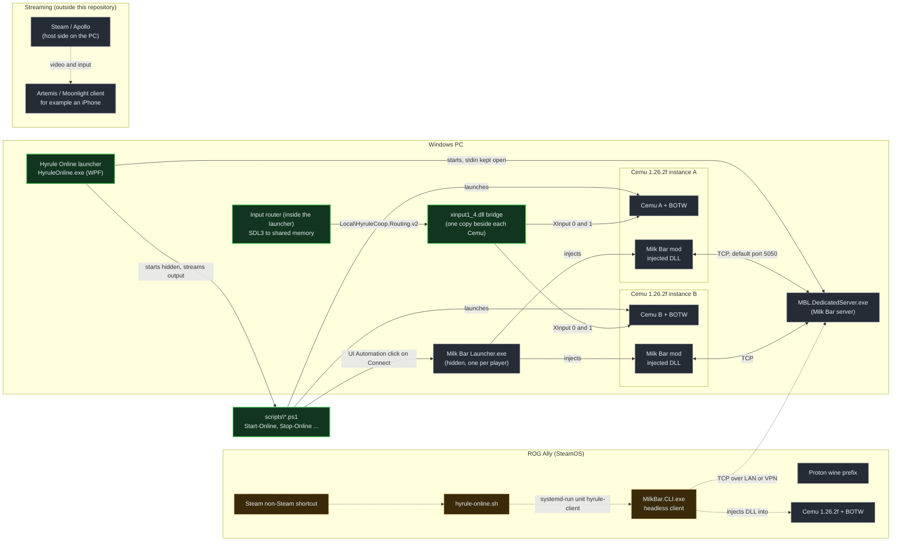

The launcher is the control point. It starts hidden PowerShell scripts, which start two Cemu instances, drive the Milk Bar launcher to inject the mod, and wait for each player to join. The launcher also runs the dedicated server itself and reads the controllers through its own SDL3 router. Streaming through Apollo or Artemis and the SteamOS client are separate: nothing in `src\` talks to Apollo or Artemis, and the Ally path was verified only against a temporary copy of the server (see [Known limits](#known-limits)).

## 2. Launcher internals

```mermaid
flowchart TB
  classDef ok fill:#12351f,stroke:#3fb950,color:#e6edf3,stroke-width:2px
  classDef unv fill:#3a2a0a,stroke:#d29922,color:#e6edf3,stroke-dasharray: 6 4
  classDef file fill:#1c2230,stroke:#6e7681,color:#e6edf3
  classDef proc fill:#262c36,stroke:#8b949e,color:#e6edf3

  subgraph UI["Launcher UI (Launcher.xaml, Launcher.cs)"]
    PLAY["Play"]:::ok
    ONL["Online<br/>Local / Host / Join"]:::ok
    GFX["Graphics"]:::ok
    WORLD["World<br/>(TabMultiplayer in code)"]:::ok
    LANG["Language"]:::ok
    HELP["Details / Help"]:::ok
  end

  subgraph SVC["Services in the launcher process"]
    SH["ServerHost<br/>runs the server, sends commands"]:::ok
    EV["ServerEvents + Roster<br/>parse the server output"]:::ok
    NH["NetworkHint<br/>classifies addresses, finds VPN adapters"]:::ok
    FW["Firewall rule<br/>netsh, elevated"]:::unv
    SC["Scripts runner<br/>powershell.exe -File scripts\x.ps1"]:::ok
    SW["Setup wizard<br/>Setup.cs, SetupWizard.cs"]:::unv
    PREF["Prefs<br/>preferences.xml"]:::ok
    RTR["Router<br/>SDL3, shared memory"]:::ok
    DSP["Layout, CemuDisplay<br/>window placement"]:::ok
    SHC["ShaderCache<br/>optional copy, off by default"]:::unv
    PG["PathGuard<br/>83 character limit"]:::ok
  end

  subgraph TOUCH["Files and processes touched"]
    INI["ServerConfig.ini<br/>.artifacts\extract\milkbar\DedicatedServer"]:::file
    UC["Milk Bar user.config<br/>serversAdded, name, model"]:::file
    LOG["%APPDATA%\BOTWM\LatestLog.txt"]:::file
    MAN["scripts\components.json"]:::file
    SMEM["Local\HyruleCoop.Routing.v2"]:::file
    DLL["xinput1_4.dll beside each Cemu"]:::file
    SRVP["MBL.DedicatedServer.exe"]:::proc
    PS1["Start-Online / Stop-Online /<br/>Install-Components / Merge-Mod / Patch-Mod ..."]:::proc
    NETSH["netsh advfirewall"]:::proc
  end

  ONL --> SH
  ONL --> NH
  ONL --> FW
  PLAY --> SC
  WORLD --> SH
  GFX --> DSP
  PLAY --> SHC
  SH --> SRVP
  SH --> INI
  SRVP --> EV
  EV --> ONL
  FW --> NETSH
  SC --> PS1
  PS1 --> LOG
  PLAY -->|"ApplyPlayers"| UC
  SW --> MAN
  SW --> PS1
  RTR --> SMEM
  PS1 --> DLL
  PREF --- UI
  PG --- SC
```

The six tabs (Play, Online, Graphics, World, Language, Details) sit on a small set of services in one process. `ServerHost` owns the dedicated server and sends commands such as time, weather and name tags to its stdin, while `ServerEvents` turns the server output into a roster of joined players. Everything that touches Cemu or the Milk Bar launcher goes through hidden PowerShell scripts run by the `Scripts` runner, which only ever stops processes under the install folder. `NetworkHint` only classifies addresses and finds VPN adapters. Nothing in the launcher may open a TCP connection to the game port, because any TCP connection without a valid handshake kills the server (see [Known limits](#known-limits)). The server finder on the Online page instead sends a UDP datagram to port 5051 on each candidate address (`HYRULE?`); a hosting launcher answers `HYRULE1 <tcp-port>` from `ServerFinder.cs` only while its server runs. A failed Join shows a fixed checklist. The setup wizard and the firewall rules are built but are not verified on a clean machine.

## 3. Play topologies

Legend for this section: solid green = implemented and verified, dashed amber = implemented but not verified, or planned.

### 3a. Local

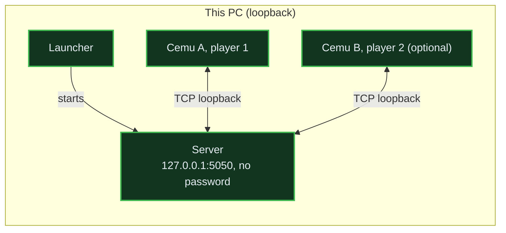

Local mode writes `IP=127.0.0.1`, port 5050 and an empty password into `ServerConfig.ini`, and runs one or two players on this PC. This is the base flow that the project was built and used with.

### 3b. Host

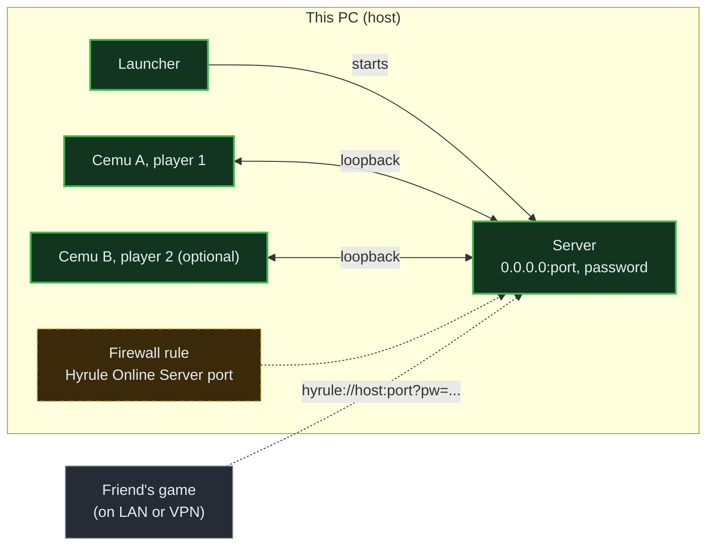

Host mode binds the server to `0.0.0.0`, takes a port (1024 to 65535), a password and a description, and builds the invite link `hyrule://host:port?pw=<password>`. The launcher prefers a Tailscale address, then the home LAN address, and offers an elevated button that adds an inbound TCP rule (and the UDP finder rule), both limited to the local subnet and Tailscale (`100.64.0.0/10`). A real second PC joining through this launcher, the player limit, and the firewall rule on a clean machine are not verified. What was verified is a TCP connect from the Ally to a temporary server copy on the LAN.

### 3c. Join

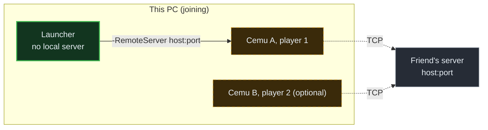

Join mode parses an invite link or `host:port`, starts no server, and passes `-RemoteServer host:port` to `Start-Online.ps1`. Join now allows one or two local players. Joining through this launcher with a real second machine is not verified.

### 3d. Ally hosts, PC joins with two players (script written, not verified)

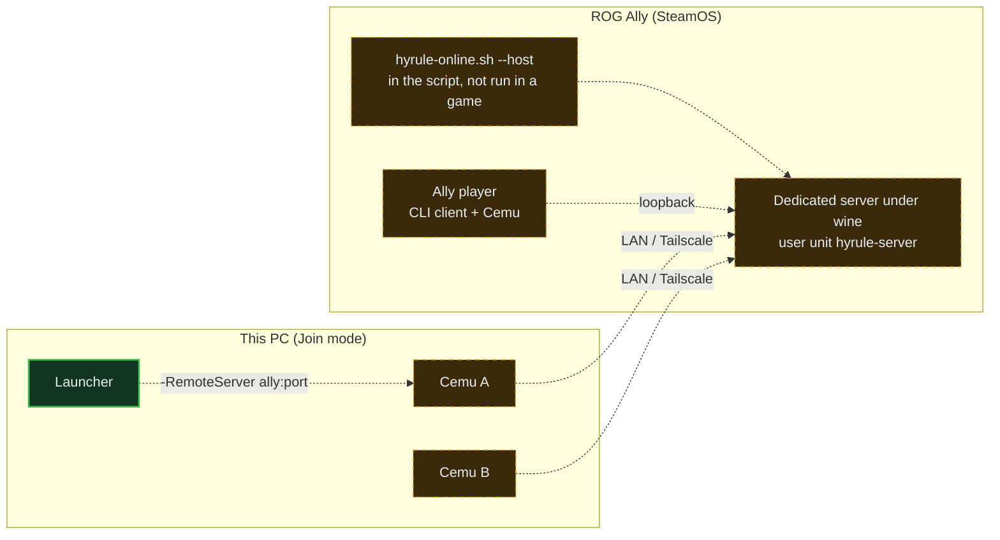

This is the case where the Ally runs the server and the PC joins with two local players while the Ally also plays. `hyrule-online.sh --host [port [password]]` now exists in the script: it writes `ServerConfig.ini` (bound to `0.0.0.0`, default port 5050), runs `MBL.DedicatedServer.exe` under wine as the user unit `hyrule-server` with stdin kept open, waits for "Server opened", shows `hyrule://` invites for the LAN and VPN addresses (it only detects an active firewall and never changes it), then joins its own server on `127.0.0.1` unless `--no-play` is given. The whole path stays dashed: it has not been run in a real three-player game, which `RESEARCH.md` lists as not verified. The server's player limit is 32 (`ServerData.PLAYERLIMIT`, read by reflection), so three players fit.

## 4. Session start

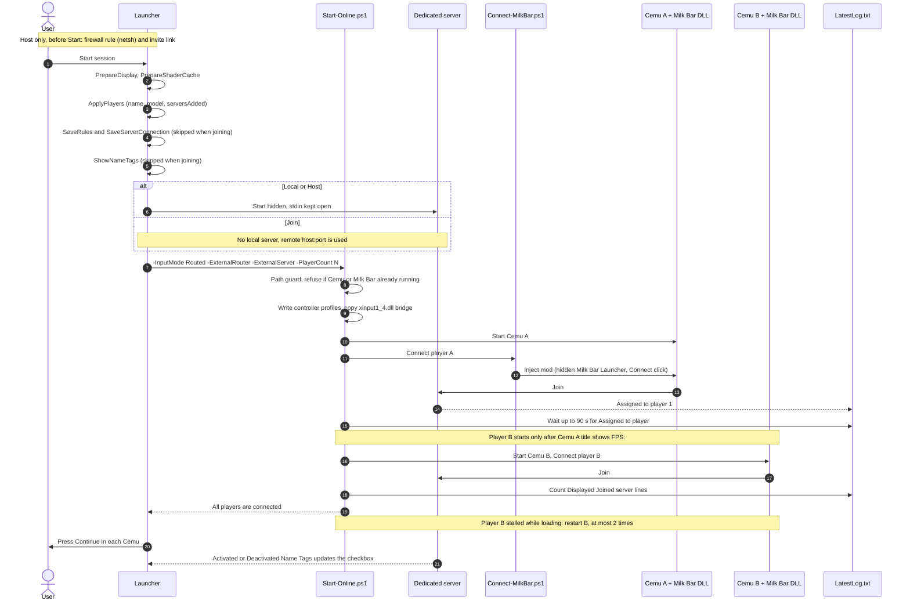

The launcher prepares displays, per-player Milk Bar settings and server rules, then runs `Start-Online.ps1`, which starts the players one after another because the Milk Bar pipe `\\.\pipe\languageConnectionPipe` takes only two instances. A player counts as joined when `%APPDATA%\BOTWM\LatestLog.txt` shows `Assigned to player` and then a `Displayed "Joined server` line. The user still presses Continue in each Cemu window (the mod's DLL scan needs it within about a minute). The script prints `All players are connected.` and the launcher updates its step indicators from the script output.

## 5. Input path

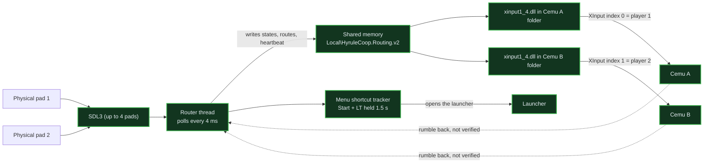

The router lives in the launcher (and in a headless `InputRouter.exe` for scripts). It reads pads through SDL3 and publishes them in a 128-byte shared-memory block. A small native C DLL named `xinput1_4.dll` sits next to each `Cemu.exe`; it answers XInput index 0 with player 1's pad and index 1 with player 2's pad, and falls back to the real XInput if the router heartbeat stops for 5 seconds. The menu shortcut (default Start + LT, held 1.5 s) is tracked per controller, hidden from the game while it is held, and answered with a short rumble pulse. While the launcher is in front of a running game, the games receive a neutral pad. The shortcut was verified with virtual pads only, and Start + Back is refused because Moonlight's quit combination includes it.

## 6. SteamOS

### 6a. Installer

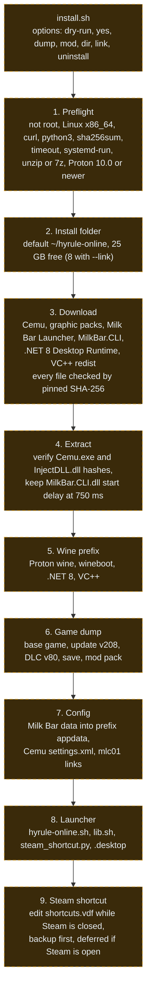

`install.sh` runs nine stages and records finished ones in `~/.config/hyrule-online/state`, so a re-run skips them. Downloads are resumable and a file that fails its SHA-256 check is deleted. The game dump is supplied by the user and is copied or linked, never downloaded. Dialogs use `zenity` in Gaming Mode and fall back to the terminal. Every stage is drawn dashed because `RESEARCH.md` records no end-to-end run of the installer on a device. The CLI patch and the Gaming Mode dialogs have no verification record there either (see [Known limits](#known-limits)).

### 6b. Join flow

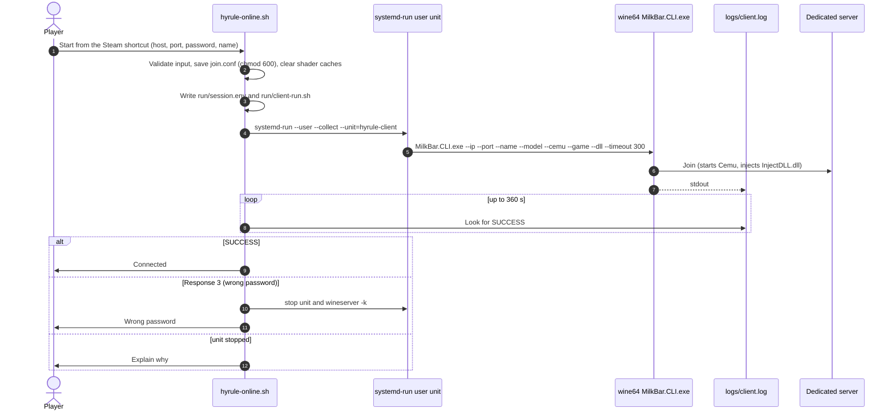

`hyrule-online.sh` validates the host, port and name, then starts the Milk Bar CLI as a user systemd unit named `hyrule-client`. It does not make a TCP pre-check, because any connection without a valid handshake kills the dedicated server. It reads `client.log` for `SUCCESS` (joined) or `"Response":3` (wrong password) and stops the unit and the wine server on failure. `--stop` ends a session by stopping the unit and `wineserver -k`.

## 7. Release and CI

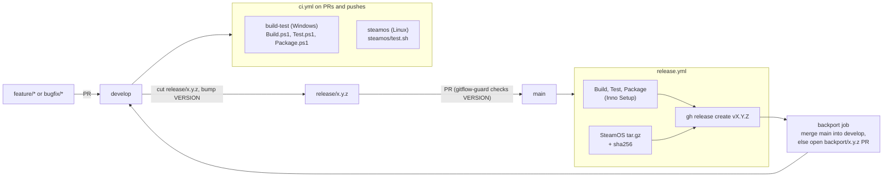

Pull requests to `main` or `develop` and pushes to `develop`, `release/**` and `hotfix/**` run two CI jobs: Windows build, tests and packaging, and the offline SteamOS script tests on Linux. `gitflow-guard.yml` only lets `release/*` or `hotfix/*` into `main`, requires the branch name to match the `VERSION` file and a new, unused tag, and limits what can enter `develop` and `release/*`. A push to `main` runs `release.yml`, which builds the Windows setup and portable zip, packs the SteamOS tarball with its SHA-256, publishes a GitHub release, and then merges `main` back into `develop`, or opens a `backport/<version>` pull request if the merge is not clean.

## 8. Third party and ours

| Component | Whose | How it gets there | Bundled in our packages? |
| --- | --- | --- | --- |
| Hyrule Online launcher (WPF), input router, XInput bridge | Ours | Built by `scripts\Build.ps1` | Yes |
| PowerShell scripts, `components.json`, Inno Setup installer script, SteamOS scripts | Ours | In this repository | Yes |
| Cemu 1.26.2f | Third party | Downloaded by the setup (Windows) or `install.sh` (SteamOS), SHA-256 pinned | Never |
| Cemu graphic packs (v989) | Third party | Same | Never |
| Milk Bar Launcher 2.0.1 (mod, injected DLL, MBL.DedicatedServer.exe) | Third party (MilkBarModding) | Downloaded from its upstream release | Never |
| MilkBar.CLI fork (CarlosEvCode) | Third party | Downloaded by `install.sh` | Never |
| BCML 3.10.8 and Python 3.8.10 | Third party | Downloaded by the setup | Never |
| SDL3 and SDL GameControllerDB | Third party | Downloaded by `Build-Input.ps1`; license files travel with the package | Runtime files and licenses only |
| zig (builds the bridge) | Third party | Downloaded by `Build-Input.ps1` | Never (build tool) |
| Proton / Wine | Third party (Valve) | Found in the user's Steam libraries | Never |
| .NET 8 Desktop Runtime and VC++ redistributable | Third party (Microsoft) | Downloaded by `install.sh` into the wine prefix | Never |
| ReShade | Third party | Placed by hand in `.tools\reshade` | Never |
| Game dump (base game, update v208, DLC v80, save) | The user's own | Supplied by the user, never downloaded | Never |

Everything in the third-party rows is fetched from its own source and checked against a pinned hash; the packages contain only this project's files (`scripts\Package.ps1`). The Milk Bar license does not allow redistribution unless substantially modified, which is why it is always downloaded.

## Known limits

All items come from `RESEARCH.md` unless marked otherwise.

- A closed stdin makes the dedicated server spin and fill `LatestLog.txt`, so the launcher keeps stdin open.
- Confirmed: any TCP connection that disconnects without a valid handshake (an empty connect, or a few junk bytes) kills the dedicated server with `ArgumentOutOfRangeException` in `ServerData.GetPlayer`, reproduced on the PC and on the Ally. So nothing may open a TCP connection to the game port: the launcher has no TCP probe or readiness check, and a port scanner on the LAN could still take a server down. Stress-tested on an isolated copy: an empty connect, an HTTP request, a port scan, junk bytes or a truncated connect frame each killed it, while valid pings, joins, a refused 33rd player, wrong passwords and a 3-minute soak with two players did not. That is why the firewall rules are scoped to the local subnet and Tailscale, and the launcher shows a "server stopped" prompt when it dies. The server finder and its Test button use UDP port 5051 instead: the request `HYRULE?` is answered with `HYRULE1 <tcp-port>` by the hosting launcher while its dedicated server runs, and the host needs an inbound UDP 5051 firewall rule ("Hyrule Online Finder").
- A real second PC joining through this launcher, the server's player limit, the right `serversAdded` entry when the list has several, and the firewall rule on a clean machine are not verified.
- The Ally joined a temporary server copy over LAN and printed "Multiplayer session active" with "Assigned to player 1". Not confirmed: the character in the world on the Ally, a second player seen in both games, and the Windows launcher's own Join button.
- A real three-player session (two on the PC plus the Ally) is not verified in game.
- Physical pads through Steam Input or Moonlight are not verified. Start + LT may collide with ZL in play; Start + LT + RT or L3 + R3 are the fallbacks.
- In the Ally client session, a D-pad press that opens an external window and Start closing the launcher have an unconfirmed cause; a key-guard defence is built but not verified there.
- Player 2 sometimes stalls while loading; the restart of B (`Cemu-Stall.ps1`) is not confirmed in game.
- The mod's DLL scan needs Continue pressed in about a minute, otherwise Cemu closes.
- The Milk Bar pipe takes two instances, so players start one after another; three or four local players are not built.
- The wizard merges the mod with BCML on its own (`Merge-Mod.ps1`); BCML drops some files, which `Patch-Mod.ps1` repairs.
- The cause of the Milk Bar JSON "Unexpected character" corruption is not proven. DLL injection may trigger antivirus.
- The shared shader cache is off by default and not verified in game. The FPS target needs a restart.
- Rotation is not verified with a real pad or gameplay. Rumble in Routed mode is not verified.
- Real Python and BCML installs, the multi-gigabyte downloads end to end, and the setup wizard on screen are not verified.
- A Cemu keyboard profile crashes Cemu 1.26.2f.
- On the Ally the mod only syncs with the CLI start delay at 750 ms. With 70 s it joined the server but never scanned the game, so nobody saw the Ally player. This was checked on a real Ally; it was not yet seen on screen with a 3-player session.
- Not covered by `RESEARCH.md`: whether the Gaming Mode `zenity` dialogs work on a real device. They come from `steamos\install.sh` and `lib.sh` and are unverified here.

## Where the code and the docs differ

- There is no `README.md`; `CONTRIBUTING.md`, `RESEARCH.md` and `steamos\README.md` are the written sources.
- `RESEARCH.md` has no separate SteamOS section: the Ally results sit in the Online page section, and the install steps are documented only in `steamos\README.md`.
- `CONTRIBUTING.md` lists only the installer and portable zip as release packages; `ci.yml` also tests the SteamOS scripts and `release.yml` also publishes the SteamOS tarball.
- `RESEARCH.md` line for the Join page still says Join is one local player and that the player count goes back to two on leaving Join; a later bullet and the code (`OnlineUi.cs`: "One or two players") say Join allows one or two.
- The World tab is called `TabMultiplayer` in the code.
- `hyrule-online.sh --host` is in the script now, but `RESEARCH.md` does not describe it yet and it has not run in a game; section 3d stays dashed.
- No code in `src\` configures Apollo, Artemis or a Steam shortcut on Windows; `New-Shortcut.ps1` only makes a desktop shortcut. Streaming appears in `RESEARCH.md` only as Moonlight notes.
